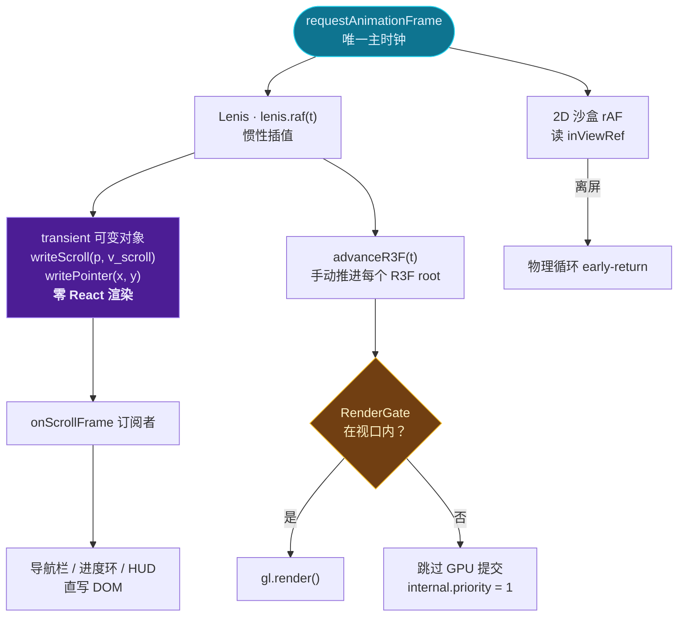
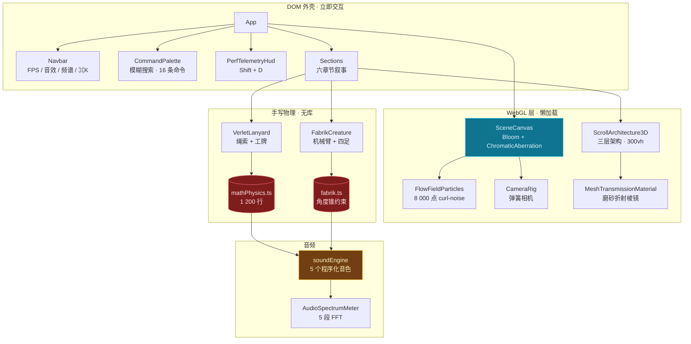
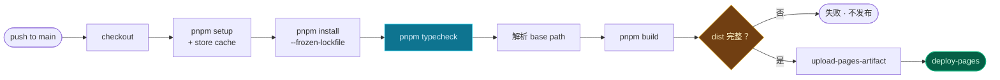

<div align="center">

# 个人数字展厅 · INTERACTIVE SHOWROOM

**一个由 WebGL、惯性滚动与实时状态编排构成的沉浸式空间。滚动即是镜头运动。**

<p>
  
  
  
  
  
</p>

<p>
  <a href="#-三十秒速览">速览</a> ·
  <a href="#-架构拓扑">架构</a> ·
  <a href="#-核心物理与数学">物理</a> ·
  <a href="#-性能体系">性能</a> ·
  <a href="#-交互地图">交互</a> ·
  <a href="#-本地运行">运行</a> ·
  <a href="#-部署">部署</a>
</p>

</div>

---

## ⚡ 三十秒速览

| 维度 | 事实 |
| :--- | :--- |
| **主时钟** | 全站 **1 个** `requestAnimationFrame`，所有动画向其对齐 |
| **滚动** | Lenis 惯性滚动，`autoRaf: false`，由主时钟手动驱动 |
| **热路径** | 鼠标 / 滚动写入**可变对象**，React 渲染数为 **0** |
| **粒子** | 8 000 个点，单 `draw call`，手写 curl-noise GLSL |
| **物理** | 手写 Verlet 绳索引擎 + 手写 FABRIK 逆运动学，**零物理库** |
| **音频** | 纯代码合成器，5 个程序化音色，**零音频文件** |
| **自适应** | 2 秒滚动均值 < 45 FPS → 自动降档（粒子减半 / DPR 1.0 / 关后处理） |
| **可访问性** | 全键盘可达 · ⌘K 命令面板 · `prefers-reduced-motion` 适配 |

> 没有一张贴图、没有一个视频、没有一段音频文件。
> 你看到的全部像素与听到的全部声音，都是运行时算出来的。

---

## 🗺 架构拓扑

### 1. 单主时钟 · 一帧的生命周期

整个应用的性能基石：**不存在第二个循环**。Lenis、R3F、所有 DOM 读数都挂在同一条时间线上。



**为什么这件事重要**：如果让 R3F 自己跑 `frameloop="always"`，就会出现两个时钟，
补偿星云会比 DOM 滚动**晚一帧**——这种「黏手感」是滚动叙事体验的头号杀手。
因此全站 `frameloop="never"`，由 Lenis 的 tick 亲手 `advanceR3F()`，
两者消费同一个 `timestamp`。

时间戳在 `frameBridge` 内统一处理：rAF 毫秒 → 减去挂载原点 → 转秒 → 单帧钳制
`MAX_DELTA_SECONDS = 0.1`（防止后台标签页恢复时物体瞬移）。

### 2. 模块拓扑



### 3. 状态架构：响应式 vs 瞬态

这是本项目最重要的约定。

**响应式**（`src/store/useAppStore.ts`）—— 低频、可持久化、精确订阅：

```ts
soundEnabled      fpsMonitorEnabled     performanceTier
activeSection     accentTheme           gravityMode
perfHudOpen       commandPaletteOpen
```

**瞬态**（`transient` 单例）—— 每帧写入，**绝不进 React**：

```ts
transient.mouse  = { x, y, px, py }        // 归一化 [-1,1] + 像素坐标
transient.scroll = { progress, velocity }  // p ∈ [0,1]；v = dp/dt
```

写入 API：`writePointer` / `writeNormalizedMouse` / `writeScroll` /
`resetMouseTransient` / `resetTransient`。

> `resetTransient()` 会清零滚动值，仅用于拆卸；
> 指针离开视口请用 `resetMouseTransient()`，否则会污染滚动状态。

```ts
// 在 R3F 中读取：不订阅、不重渲染
useFrame(() => {
  const { mouse, scroll } = getTransient()
  // ...直接驱动 ref.current
})
```

### 4. 目录结构

```
interactive-showroom2/
├── src/
│   ├── lib/
│   │   ├── scrollEngine.ts       # 主时钟 + Lenis 封装（唯一的 rAF）
│   │   ├── frameBridge.ts        # 引用计数式 R3F 推进器
│   │   ├── perfMetrics.ts        # 免分配性能计数器
│   │   └── fuzzyMatch.ts         # 命令面板模糊匹配 + 评分
│   ├── store/useAppStore.ts      # Zustand 反应式状态 + 瞬态可变对象
│   ├── utils/
│   │   ├── mathPhysics.ts        # Verlet 引擎 · 约束求解 · 贝塞尔
│   │   ├── fabrik.ts             # FABRIK IK · 角度锥约束
│   │   └── soundEngine.ts        # Web Audio 程序化合成器
│   ├── components/
│   │   ├── canvas/               # R3F 场景 · 几何构建 · 相机路径
│   │   ├── sandbox/              # VerletLanyard · FabrikCreature
│   │   ├── bento/                # Bento Grid · 聚光灯卡片 · 终端
│   │   ├── command/              # ⌘K 命令面板
│   │   └── sections/             # 叙事章节
│   ├── hooks/
│   │   ├── useInViewAnimation.ts # 统一视口休眠
│   │   └── useSectionProgress.ts # 章节 0→1 进度
│   └── index.css                 # Tailwind v4 @theme · 强调色主题
├── scripts/                      # 无头 Chrome 验证脚本
└── .github/workflows/deploy.yml  # CI/CD
```

### 5. z-order 约定

| 层级 | 内容 |
| :--- | :--- |
| `z-0` | 环境背景（径向渐变 / 网格 / 暗角 / 扫描线） |
| `z-10` | WebGL 画布（`pointer-events-none`） |
| `z-15` | 内容遮罩层 |
| `z-20` | 页面内容 |
| `z-80/90` | 遥测 HUD |
| `z-120` | 命令面板 |

---

## 🧮 核心物理与数学

> 全部手写实现，没有 `cannon`、没有 `rapier`、没有 `mathjs`。
> 每个数值都是在这个尺度下调出来的，注释里记着调参时的实测数据。

### 1. Verlet 积分 · 定长步进

位置形式的 Verlet，天然能量守恒，无需显式存速度：

```
xₙ₊₁ = xₙ + ξ·(xₙ − xₙ₋₁) + aₙ·Δt²

Δt  = 1/60 s          固定步长，帧率无关
ξ   = 0.93            阻尼（能量耗散）
max 4 steps/frame     累加器上限，防止切页后补帧爆炸
```

> **为什么固定步长**：可变 `Δt` 会让弹簧刚性随帧率漂移——同一条绳在 60 Hz 与
> 144 Hz 下行为不同。固定步长 + 累加器保证跨设备物理一致。

### 2. 加速度合成

```
a = g·γ + W(t)·ℓ + P(d)

γ ∈ { 0, 1/6, 1, 2.6 }     零重力 / 月球 / 地球 / 超重
g = 1900 px·s⁻²            沙盒尺度下的地球重力
ℓ = i / N                  杠杆臂：越靠下的点摆幅越大
P(d)                       鼠标斥力，半径 R = 2.5，强度 34
```

> **月球重力恰好是 1/6**，不是估的。`γ` 做成倍率而非绝对值，换重力不必重推常数。
> 零重力是合法的 `0`，必须避免被当成「未设置」。

### 3. 风场

```
W(t) = A · sin(ω₁t) · cos(ω₂t)
```

两条不同频率的正弦相乘，产生**非周期性**往复——单个正弦会让所有绳索同步摆动，
一看就是程序。每条绳索有独立的 `windPhase` / `windGain`：

```
实测静置角度： −5.4°  −11.86°  +7.34°  +4.07°
```

### 4. 约束求解 · Gauss-Seidel 松弛

距离约束，逐点修正 `N = 12` 次：

```
|pᵢ − pᵢ₊₁| = L₀

Δ  = (|d| − L₀) / |d|
pᵢ   += wᵢ · Δ · d̂
pᵢ₊₁ −= wᵢ₊₁ · Δ · d̂
```

**应变**与断裂：

```
strainᵢ = (|pᵢ − pᵢ₊₁| − L₀) / L₀

max(strain) > 2.5  ⟹  绳索断裂
```

> ⚠️ **踩过的坑**：完全松弛会把误差抹平，峰值应变永远到不了 0.89。
> 解法是把「被抓住的那一点」作为**每轮迭代的硬约束**注入求解器，
> 让绳索吸收一个无解误差，才测到真正的 2.501 并触发断裂。

### 5. FABRIK 逆向运动学

Backward 与 Forward 两趟扫描交替进行：

```
Backward:  p′ₙ = target
           p′ᵢ = p′ᵢ₊₁ + Lᵢ · (pᵢ − p′ᵢ₊₁) / |pᵢ − p′ᵢ₊₁|

Forward:   p″₀ = bone₀
           p″ᵢ = p″ᵢ₋₁ + Lᵢ · (p′ᵢ − p″ᵢ₋₁) / |p′ᵢ − p″ᵢ₋₁|
```

**角度锥约束**（保刚性旋转整个子链，不破坏骨长）：

```
Δθ = clamp(θ − θ_ref, −θ_max, +θ_max) − (θ − θ_ref)
```

```
机械臂   6 骨  maxBend 100°  iterations 18  tolerance 0.5 px
四足腿   2 骨  maxBend 150°  （从 78° 上调）
```

> ⚠️ **难解的几何题**：膝盖锥限制在 78° 时，髋→足的最小可达距离是
> `√(a² + b² − 2ab·cos(180°−θ)) = 65.5 px`，而站姿只有 63 px —— 永远够不着。
> 表现是 IK 残差 11–20 px，**并且它掩盖了另一个 bug**：脚在滑。
> 上调到 150°（下限 23 px）后两个问题才同时暴露、同时修好。

### 6. 无散度 curl noise

标量噪声无法表达「绕流」。用向量势 ψ 的旋度构造无散度场：

```
v = ∇ × ψ,     ∇ · v = 0
```

有限差分求旋度，步长 `FD_EPS = 0.03`。

> ⚠️ `FD_EPS` 最初取 0.14，截断误差把流场变成「有源」的，粒子会聚成团再炸开。
> 降到 0.03 才恢复成丝绢状。

### 7. 弹簧（相机 / 倾斜 / 冲击回弹）

```
a = −k·(x − x₀) − c·v
v += a·Δt ;  x += v·Δt         半隐式欧拉，无条件稳定
```

```
相机   k = 46,  c = 12
倾斜   stiffness 210, damping 22
冲击   stiffness 340, damping 17
```

> 全站禁止线性 `transition`：要么 Hooke 弹簧，要么 `cubic-bezier`。

### 8. 步态相位控制（四足）

```
stride = |v_com| · Δt

stride > S_threshold(=22)  ⟹  抬起该腿
摆动轨迹：抛物线，lift = 19 px，duration = 0.19 s
```

**对角小跑**（trot）：`{LF, RR}` 与 `{RF, LR}` 两组交替，且**互斥**——
第二组必须等第一组完全落地并锁定（`GROUP_LOCK_TIME = 0.07 s`）才允许起步。

> ⚠️ 最早四腿同侧一起抬，像游泳不像走路。根因是「世界空间锚点」缺失：
> 脚跟着身体平移，永远攒不出步差（实测 `stepCount [2,2,0,0]`）。

---

## 📈 性能体系

### 渲染档位

| | `high`（默认） | `medium`（降档后） |
| :--- | :--- | :--- |
| 粒子数 | **8 000** | **4 000** |
| 设备像素比 | `≤ 2.0` | **`1.0`** |
| 后处理 | Bloom + ChromaticAberration + Vignette | Vignette |
| 触发条件 | — | 2 秒滚动均值 **< 45 FPS** |

降档判据来自 drei `PerformanceMonitor`：`ms=250 × iterations=8 = 2 000 ms` 窗口。
**手动选档会解除自动降档**——用户按下按钮就不该被程序覆盖。

### 三层休眠

```
① 2D 沙盒      IntersectionObserver → 物理循环 early-return
② R3F 主渲染    RenderGate → internal.priority = 1（跳过 gl.render）
③ 重型子树      {awake && <Rig/>} → 卸载，停掉 transmission FBO 自渲染
```

> ⚠️ **为什么需要第 ③ 层**：读 R3F 源码可知，手动 `advance()` 路径下
> `update()` 会**无条件** `gl.render()`，`internal.active` 与 `frameloop`
> 只在它自己的 `loop()` 里生效。唯一有效的开关是 `internal.priority`。
> 但 `MeshTransmissionMaterial` 会在自己的 `useFrame` 里额外渲染一次 FBO，
> 不受 `priority` 约束——实测离屏帧计数仍以**半速**前进，正好是两帧里少了一帧。

实测收益：

```
离屏 R3F 帧计数增量   540  →  0
2D 沙盒位置增量       持续变化  →  0
```

### 内存验证

```bash
node scripts/verify-leaks.mjs
```

对 `gl.info.memory` 与 `gl.info.programs` 做 **3 轮挂载/卸载 + 3 轮换档**：

```
arch.geometries  Δ 0    arch.textures  Δ 0    arch.programs  Δ 0
bg.geometries    Δ 0    bg.programs    Δ 0
```

7 处项目自建 GPU 资源全部在 `useEffect` 清理函数中 `.dispose()`：

| 资源 | 位置 |
| :--- | :--- |
| `solid` / `wire` 网格 | `InfrastructureLayer` |
| `edgeGeo` / `nodeGeo` | `OrchestrationLayer` |
| `prism` 棱镜 | `SpatialLayer` |
| 数据流 `geo` | `DataStreams` |
| 导管 `geo` + `ShaderMaterial` | `InterLayerConduits` |
| 粒子 `BufferGeometry` + `ShaderMaterial` | `FlowFieldParticles` |

> 贴图与 FBO 全部来自 drei（`Environment` / `MeshTransmissionMaterial`），由 drei 自行释放。
> 粒子几何体以 `count` 为依赖重建，清理 effect 同样以 `[geometry, material]` 为依赖，
> 因此换档时旧缓冲会被正确释放。

---

## ⌨ 交互地图

| 快捷键 | 行为 |
| :--- | :--- |
| <kbd>⌘</kbd>/<kbd>Ctrl</kbd> + <kbd>K</kbd> | 打开 / 关闭命令面板 |
| <kbd>↑</kbd> <kbd>↓</kbd> | 导航结果 |
| <kbd>Enter</kbd> | 执行选中命令 |
| <kbd>Esc</kbd> | 关闭面板 / 退出图层详情 |
| <kbd>Shift</kbd> + <kbd>D</kbd> | 性能遥测 HUD |

### 命令面板

复刻 Raycast / Linear 手感，**16 条命令 · 4 个分组**：

```
跳转章节     入口 · 展厅 · 架构 · 沙盒 · 档案 · 通讯
物理沙盒     零重力 · 月球重力 · 超重模式 · 地球重力
主题强调色   翡翠绿 · 赛博紫 · 钛金橙 · 信号青
操作         复制邮箱 · 下载简历 JSON
```

模糊匹配支持**连续子串 > 子序列**分级、前缀 / 词边界 / 连续段加权，
并带隐藏英文别名——输入 `violet` 可命中 `赛博紫`。
中文输入法 `isComposing` 期间不拦截 <kbd>Enter</kbd>。

> 主题切换只做一件事：覆盖 `--color-signal-cyan` 一个 CSS 变量。
> Tailwind v4 把 `text-signal-cyan` 编译成 `var()` 引用，于是全站瞬时换色，
> **切换成本 = 一次属性写入，而非一次 React 渲染**。

### 移动端

| 场景 | 处理 |
| :--- | :--- |
| Bento Grid | 单列卡片流，行高跟随内容（`auto-rows-[auto]`） |
| 鼠标光斑 | `(hover: none)` → 自动呼吸光效 + 陀螺仪偏移 |
| 拖拽工牌 | canvas 上精确 `touch-action: none` |
| 下拉刷新 | 文档级 `overscroll-behavior-y: none` |

> 光斑原本由 `group-hover` 触发——触摸屏**根本没有 hover 状态**，
> 整层 spotlight 在手机上永远透明。现在由 `[data-spotlight='ambient']`
> 解除门控，并用一条 17s/23s 双周期的 Lissajous 曲线驱动。

---

## 🚀 本地运行

### 环境要求

```
Node   ≥ 20.19.0     （Vite 8 要求）
pnpm   ≥ 9           （lockfile v9；CI 固定 11.8.0，即生成 lockfile 的版本）
```

### 启动

```bash
pnpm install      # 安装依赖
pnpm dev          # 开发服务器 → http://localhost:5173
pnpm typecheck    # 仅类型检查（tsc -b --noEmit）
pnpm build        # 类型检查 + 生产构建 → dist/
pnpm preview      # 预览生产包
```

> 端口 5173 被占用时 Vite 会自动顺延（`strictPort: false`），
> 或显式指定：`pnpm dev --port 5250`。

### 环境变量

| 变量 | 默认 | 说明 |
| :--- | :--- | :--- |
| `VITE_BASE_PATH` | `/` | 部署子路径。GitHub Pages 项目站由 CI 自动注入 `/<repo>/` |

```bash
# 模拟 GitHub Pages 项目站的构建
VITE_BASE_PATH=/interactive-showroom2/ pnpm build
```

### 验证脚本

仓库自带无头 Chrome（CDP）验证脚本，覆盖滚动、粒子、变形、Bento、终端、
架构、物理沙盒、FABRIK、音效、频谱、性能降档、命令面板与移动端：

```bash
node scripts/smoke.mjs                  # 冒烟：异常 / 请求 / 溢出
node scripts/verify-perf-audit.mjs      # 性能审计（22 断言）
node scripts/verify-command-mobile.mjs  # 命令面板 + 移动端（28 断言）
node scripts/verify-leaks.mjs           # GPU 资源泄漏（11 断言）
```

运行方式（以 `verify-leaks` 为例）：

```bash
# 终端 1：开发服务器
pnpm dev --port 5279

# 终端 2：带调试端口的 Chrome
chrome --headless=new --remote-debugging-port=9359 \
       --user-data-dir=%TEMP%\showroom-chrome about:blank

# 终端 3：执行
node scripts/verify-leaks.mjs http://127.0.0.1:5279
```

---

## 📦 部署

推送到 `main` 即自动发布到 GitHub Pages。



**一次性配置**：`Settings → Pages → Build and deployment → Source` 选择 **GitHub Actions**。

工作流要点：

- **依赖缓存**：`actions/setup-node` 的 `cache: pnpm`，键为 `pnpm-lock.yaml`
- **类型检查独立成步**：类型错误显示为红色的 `Typecheck` check，而非埋在构建日志里
- **`--frozen-lockfile`**：lockfile 与 `package.json` 不一致时直接失败，绝不在 CI 静默解析出另一棵树
- **产物校验**：`dist/index.html` 与 JS 产物缺失则中止，避免发布白屏
- **`needs: build`**：类型错误永远到不了发布步骤
- **`concurrency` 不取消进行中的发布**：中途取消会留下半写入的 artifact
- **最小权限**：仅 `contents: read` / `pages: write` / `id-token: write`

---

## ♿ 可访问性

- 全部交互元素可 Tab 可达，`focus-visible` 有明确青色描边
- 命令面板是标准 `combobox` + `listbox`，`aria-activedescendant` 同步高亮
- 3D 图层点击对应真实 DOM 弹层（`role="dialog"`），而非不可聚焦的 canvas 内容
- 沙盒 canvas 带 `role="application"` 与中文 `aria-label`
- 尊重 `prefers-reduced-motion`
- 中文输入法保护：`isComposing` 期间不拦截 <kbd>Enter</kbd>

---

## 🧭 工程约束

这些规则写在仓库开发规范里，所有代码都遵守：

```
① 不允许第二个 rAF 循环        主时钟唯一
② 不允许在 rAF / useFrame 里 setState
③ 不允许在帧循环里分配对象      new Vector3() 一律提到外层
④ 不允许线性 transition         弹簧或 cubic-bezier
⑤ 不允许 any                    严格模式 + verbatimModuleSyntax
```

---

## ⚠️ 版本约束

`postprocessing@6.39` 的 peer 依赖要求 `three >= 0.168 < 0.187`，
因此 `three` 锁定在 `^0.186.1`，**请勿直接升级到 0.187**。

---

<div align="center">

**Built with a single clock, zero physics libraries, and no asset files.**

`scroll → lens → physics → sound`

</div>
